# Payment Workflow Report

This document outlines the two primary payment workflows in the application: the Community Owner Subscription workflow and the User Joins Paid Community workflow. Both processes leverage Razorpay for payment processing.

---

## Diagram

```mermaid
graph TD
    subgraph "Workflow 1: Community Owner Subscription"
        A[Admin clicks 'Subscribe'] --> B{POST /api/community-subscriptions/create};
        B --> C[Creates Customer & Subscription in Razorpay];
        C --> D{Returns Razorpay short_url};
        D --> E[User pays on Razorpay page];
        E --> F{Redirect back to App};
        F --> G{POST /api/community-subscriptions/verify};
        G --> H[Verifies signature & activates subscription];
    end

    subgraph "Workflow 2: User Joins Paid Community"
        U_A[User clicks 'Join'] --> U_B{POST /api/community/join};
        U_B -- Payment Required (402) --> U_C[Renders CommunityJoinPayment UI];
        U_C --> U_D[User selects plan & pays via Razorpay];
        U_D --> U_E{Creates Transaction record};
        U_E --> U_F{POST /api/community/join-paid};
        U_F --> U_G[Verifies Transaction & adds user to members];
    end

    style A fill:#f9f,stroke:#333,stroke-width:2px
    style U_A fill:#ccf,stroke:#333,stroke-width:2px
```

---

## Workflow 1: Community Owner Subscription

This workflow details the process for a community administrator to activate a paid subscription for their community, enabling premium features. The subscription is a fixed-price plan of $29/month.

1.  **Initiation**: The community admin navigates to the community's billing settings and clicks a "Subscribe" button.

2.  **Subscription Creation**:
    *   A `POST` request is sent to the `/api/community-subscriptions/create` endpoint.
    *   The backend first checks if a Razorpay `customer` exists for the admin user. If not, one is created.
    *   A Razorpay `subscription` is then created using a predefined plan ID stored in environment variables. This plan includes a 14-day trial period that is managed within our application, not by Razorpay's native trial functionality.
    *   A corresponding `CommunitySubscription` document is created in the local database to track the subscription state.

3.  **Payment Authorization**:
    *   The API returns a `short_url` provided by Razorpay.
    *   The frontend redirects the user to this URL, which leads to a secure Razorpay-hosted page where the admin authorizes the subscription and initial payment.

4.  **Verification and Activation**:
    *   Upon successful payment authorization, Razorpay redirects the user back to the application.
    *   The frontend receives payment details (`razorpay_payment_id`, `razorpay_subscription_id`, `razorpay_signature`) from the redirect URL.
    *   A `POST` request containing these details is sent to the `/api/community-subscriptions/verify` endpoint.
    *   The backend uses the `razorpay_key_secret` to verify the cryptographic signature from Razorpay, ensuring the transaction is authentic.
    *   If the signature is valid, the backend activates the subscription by updating the status in the `CommunitySubscription`, `User`, and `Community` models to "active". It also creates a `Transaction` record for historical purposes and clears any trial-related data.

---

## Workflow 2: User Joining a Paid Community

This workflow outlines the process for a regular user to join a community that requires payment for membership.

1.  **Join Attempt**: A user clicks the "Join" button on the page of a paid community.

2.  **Payment Requirement Check**:
    *   A `POST` request is sent to the `/api/community/join` endpoint.
    *   The backend logic checks the `Community` model to see if the `paymentEnabled` and `subscriptionRequired` flags are set to `true`.
    *   If payment is required, the API returns a `402 Payment Required` status.

3.  **Payment UI Display**:
    *   The frontend intercepts the `402` status and dynamically renders the `CommunityJoinPayment` React component.
    *   This component fetches the specific payment plans configured for that community and displays them to the user.

4.  **Payment Execution**:
    *   The user selects a payment plan and completes the payment through a Razorpay checkout form presented by a component like `PayNowButton`.
    *   A `Transaction` record is created in the database to log the payment.

5.  **Membership Finalization**:
    *   After a successful payment, the frontend calls the `/api/community/join-paid` endpoint in a `POST` request, passing the `transactionId`.
    *   The backend verifies that the transaction is valid, belongs to the correct user and community, and has a "captured" status.
    *   Upon successful verification, the user's ID is added to the `members` array in the community's document, officially making them a member.

6.  **Confirmation**: The user is redirected to the community's main feed, now with full member access. 